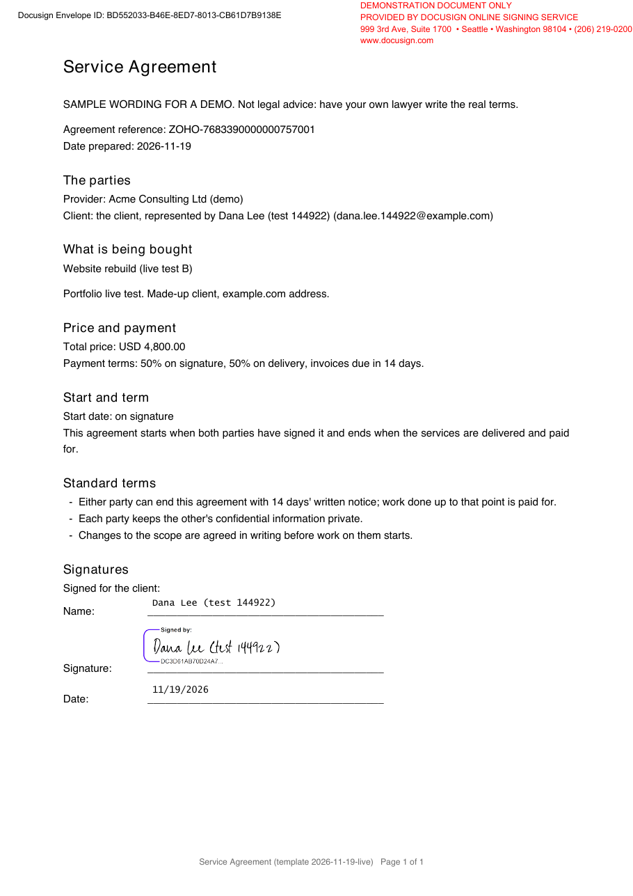
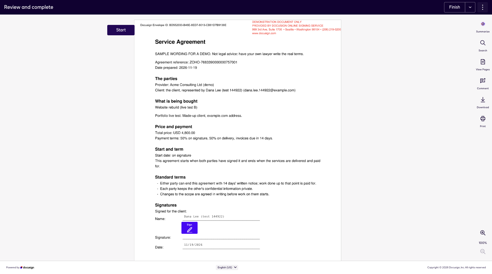

# DocuSign CRM Envelope Sender

[](https://github.com/ParishSynthMind/docusign-crm-envelope-sender/actions/workflows/tests.yml)

When a deal in the CRM (**HubSpot**, **GoHighLevel** or **Zoho CRM**) reaches the "send the contract" stage, this service:

- reads the deal and its contact, checks them (a signer name, a real email, an amount),
- fills a contract template and turns it into a PDF (with invisible anchors where the signature, name and date go),
- parks it as **waiting for approval** and says so on the deal, so a person checks it first,
- after approval, creates a **DocuSign envelope** through the eSignature REST API (JWT grant), with **email** signing (DocuSign emails the signer) or **embedded** signing (we hand out a signing link),
- listens to **DocuSign Connect** webhooks (HMAC-SHA256 checked) for delivered, completed, declined and voided,
- on completion downloads the **signed PDF** and the **certificate of completion**, stores them with their SHA-256, and writes the status, envelope id and signed time back to the deal, with a note.

Every step goes into a hash-chained audit log. Nothing goes out without a person's approval, and nothing is sent twice.

<!-- LIVE-STATUS -->
**Status (19 Nov 2026): tested live** on a free DocuSign developer (demo) account and a Zoho CRM test org. A signed Zoho-style stage webhook created a contract waiting for approval (written back to the real Zoho deal), the approval API created a real envelope, the test signer signed it in an embedded signing session, DocuSign Connect sent HMAC-signed `sent`, `delivered` and `completed` events to the server through a public HTTPS tunnel, and the signed PDF, the certificate and `DocuSign_Status = completed` landed where they should. A second envelope was voided through the API and Connect confirmed it. 239 offline tests in CI.
<!-- /LIVE-STATUS -->



*The real signed PDF from the live run (19 Nov 2026), made-up client, demo account watermark. The reference `ZOHO-…` is the Zoho deal id; the envelope id is stamped top left.*

## How it works

```mermaid
flowchart LR
    C[CRM: deal reaches stage] -->|signed webhook| W[/webhooks/hubspot, ghl, zoho/]
    W -->|signature OK, new delivery| R[read deal + contact]
    R --> K{checks}
    K -->|missing email, amount...| F[failed: note on the deal + alert]
    K --> P[template -> PDF + SHA-256]
    P --> A[pending_approval: note on the deal]
    H[person: approve] -->|compare-and-set| E[find envelope by request key<br/>or create it: eSignature v2.1]
    E -->|status, envelope id| C
    D[DocuSign Connect] -->|HMAC-SHA256| X[/webhooks/docusign/]
    X -->|completed| S[download signed PDF + certificate<br/>store + hash]
    S -->|completed, signed time, note| C
    Q[reconcile, on a schedule] -->|poll open envelopes| D
```



1. **Stage webhook.** HubSpot's v3 signature (HMAC-SHA256 over method, URI, body and timestamp, 5-minute window), or for GoHighLevel and Zoho workflow webhooks a shared HMAC (`X-Webhook-Signature: sha256=…`) or a long shared token. Checked on the raw bytes before anything is parsed. A CRM retry of the same delivery is answered and ignored.
2. **One contract per deal and stage.** The request key `crm:deal:stage:template_version` is unique: however many webhooks arrive, one contract is made. A new template version makes a new one on purpose.
3. **Checks before anything is generated.** No signer name, no valid email, no amount, or an amount that is not a number: the request is marked `failed`, the deal gets a note saying what to fix, and a named person gets an alert. `esign-crm retry <id>` re-runs it after the deal is fixed.
4. **Contract.** A Markdown-like template (`templates/`) with `{{placeholders}}` and `[[signature:client]]`, `[[name:client]]`, `[[date:client]]` lines (and `:countersigner`). CRM values cannot inject placeholders or markers. The PDF's SHA-256 is stored; if the file changes before sending, the send stops.
5. **Human approval** (CLI `esign-crm approve <id>` or `POST /requests/<id>/approve` with the approver token). Deals above `max_amount` need `--confirm-large`; a daily envelope cap stops runaway sends; `paused: true` is the kill switch.
6. **Envelope, exactly once.** The envelope carries hidden custom fields (request key, CRM, deal id). Before creating one we search for an envelope with that request key (a crash or timeout after DocuSign accepted it), and adopt it instead of sending a second. A create that times out or gets a 5xx is treated as "maybe sent": we look again before deciding.
7. **Signing.** Email mode: DocuSign emails the signer. Embedded mode: the signer has a `clientUserId` (DocuSign sends them no email) and `GET /requests/<id>/sign` redirects to a fresh 5-minute signing session. An optional countersigner from our side signs second.
8. **Status back.** Each envelope subscribes to Connect (JSON, SIM mode, HMAC on). Statuses only move forward (an old `delivered` arriving after `completed` is ignored), duplicates are dropped, and a failed download answers 500 so DocuSign retries. `esign-crm reconcile` on a schedule catches anything a missed webhook skipped. The CRM write-back failing never loses the status: it is alerted and `esign-crm resync <id>` repeats it.



*Live embedded signing session, 19 Nov 2026: the signature box sits on the anchor under the name (an earlier envelope showed it covering the name line; fixed and covered by a test, see Honest limits).*

## Setup

1. **DocuSign developer account** (free, no card) at developers.docusign.com. In Admin > Apps and Keys: add an app (integration type *Private custom integration*), upload an RSA public key (generate the pair yourself, keep the private key in your secret store), add the redirect URI `https://developers.docusign.com/platform/auth/consent`. Note the User ID and API Account ID on the same page.
2. **Consent, once:** `esign-crm consent-url` prints the link; open it signed in as the sending user and click Allow Access. `esign-crm check-auth` then proves the JWT grant works (prints the account name and the last 4 characters of its id, no secrets).
3. **Connect key:** Admin > Connect > Connect Keys > Add Secret Key. Store it as the Connect HMAC key. (Each envelope carries its own Connect subscription, so no account-level configuration is needed; the account key signs those events too, proven live.)
4. **Secrets** (never in a file): environment variables or the macOS Keychain.

   | What | Environment variable | Keychain item |
   |---|---|---|
   | DocuSign integration key | `DOCUSIGN_INTEGRATION_KEY` | `docusign-integration-key` |
   | DocuSign user id (GUID) | `DOCUSIGN_USER_ID` | `docusign-user-id` |
   | RSA private key (PEM, base64 PEM or hex) | `DOCUSIGN_PRIVATE_KEY` | `docusign-private-key` |
   | API account id (optional, default account otherwise) | `DOCUSIGN_ACCOUNT_ID` | `docusign-account-id` |
   | Connect HMAC key | `DOCUSIGN_CONNECT_HMAC_KEY` | `docusign-connect-hmac-key` |
   | HubSpot private app token + app client secret | `HUBSPOT_ACCESS_TOKEN`, `HUBSPOT_CLIENT_SECRET` | `hubspot-esign-token`, `hubspot-esign-client-secret` |
   | GoHighLevel private integration token + webhook secret | `GHL_ACCESS_TOKEN`, `GHL_WEBHOOK_SECRET` | `ghl-esign-token`, `ghl-esign-webhook-secret` |
   | Zoho client id, secret, refresh token + webhook secret | `ZOHO_CLIENT_ID`, `ZOHO_CLIENT_SECRET`, `ZOHO_REFRESH_TOKEN`, `ZOHO_WEBHOOK_SECRET` | `zoho-client-id`, `zoho-client-secret`, `zoho-refresh-token`, `zoho-esign-webhook-secret` |
   | Approver token for the HTTP approval API | `APPROVER_TOKEN` | `esign-approver-token` |

5. **Install** (exact versions):
   ```bash
   python -m venv .venv && . .venv/bin/activate
   pip install -r requirements.lock && pip install -e . --no-deps
   ```
6. **Settings** in `config/sender.yaml`: business name, `environment` (demo or production), `crm`, the trigger stage per CRM, template and its version, `signing_mode`, countersigner, caps, `paused`. `ESIGN_PUBLIC_URL` is the HTTPS address DocuSign Connect calls back.
7. **CRM fields:** `esign-crm setup-fields` creates the status, envelope id and completed-at fields (safe to re-run; for GoHighLevel create them by hand and put their ids in `ghl_field_ids`).
8. **Run** behind HTTPS, and point the CRM's stage webhook at `/webhooks/hubspot`, `/webhooks/ghl` or `/webhooks/zoho`:
   ```bash
   esign-crm serve --port 8000
   esign-crm list --status pending_approval
   esign-crm approve 12                 # sends it
   esign-crm reject 12 --reason "wrong price"
   esign-crm void 12 --reason "terms changed"
   esign-crm sign-url 12                # embedded mode
   esign-crm reconcile                  # on a schedule (catches missed webhooks)
   esign-crm audit-verify
   ```

## Try it without any account

```bash
pytest -v                       # 239 tests, DocuSign and the CRMs faked
python scripts/local_run.py     # the whole flow through the real app: fake HubSpot + fake DocuSign
```

## What was proven live and what was mocked

| Part | Status |
|---|---|
| JWT grant (RS256 assertion, consent, `/oauth/userinfo`, base URI from the account) | **Proven live** 19 Nov 2026, DocuSign demo account |
| Envelope creation (PDF, anchor tabs, hidden custom fields, embedded signer), idempotency lookup by custom field | **Proven live**: 2 envelopes (`examples/live-run/run-log.json`) |
| Embedded signing session (recipient view) signed in a browser | **Proven live**: `media/live-embedded-signing.png`, `media/live-adopt-signature.png`, `examples/live-run/signed-contract.pdf` |
| DocuSign Connect webhooks with HMAC-SHA256 (per-envelope subscription, JSON SIM) | **Proven live** through a cloudflared tunnel: `envelope-sent`, `envelope-delivered`, `envelope-completed`, `envelope-voided` all verified and recorded |
| Signed PDF + certificate of completion download and hashing | **Proven live** (certificate kept private; a redacted text copy is in `examples/live-run/`) |
| Void with a reason through the API | **Proven live** on envelope 1 |
| Zoho CRM: read deal + contact, create the 3 fields, write status and notes (API v8) | **Proven live** on a Zoho test org |
| Zoho stage webhook | The request was signed and sent by `scripts/live_run.py` in Zoho's shape; a Zoho workflow rule was not configured in the test org |
| HubSpot and GoHighLevel adapters, their webhook signatures | **Mocked only** (tested against fakes of their APIs, v3 and API v2 `Version: 2021-07-28`) |
| Email signing mode, countersigner, declined | Mocked (the live run used embedded signing to avoid emailing a made-up address) |
| Production DocuSign (go-live review) | Never run: demo only |
| Hosting | Run from a Mac through a temporary tunnel for the test; no permanent host |
| Heartbeat / failure alerts | Tested offline; alert targets are the client's (env vars) |

## Honest limits

- **Found and fixed in the live run:** DocuSign's signature box is taller than a text row, so on the first live envelope it covered the name line above it. The signature row now has extra space above it (`test_signature_line_has_room_for_the_signature_box`); the second envelope shows it sitting cleanly on its line. Envelope 1 was voided with that reason.
- The contract template is simple (headings, paragraphs, bullets, one page or more). For a designed contract, upload a DOCX or PDF template to DocuSign and switch to server templates; the anchors and the rest of the flow stay the same.
- The sample contract wording is a demo, **not legal advice**. E-signature validity depends on the country and the document type; check with a lawyer before using it for real contracts.
- Embedded signing means the business is responsible for identifying the signer before handing out the link (`authenticationMethod` is recorded as `none`).
- Going to production needs DocuSign's go-live review of the integration key (about 20 successful API calls on demo, then a request in the developer account).
- A personal or regulated deal (health, finance) needs the client's data rules checked first; the PDFs are stored on the server's disk (`storage_dir`), so that disk needs backups and access control.
- Never used for a client yet: this is a portfolio build.

## Security

- **Signatures first:** every webhook is checked on the raw body before parsing (HubSpot v3 with a 5-minute replay window, shared HMAC for GHL/Zoho, DocuSign Connect HMAC-SHA256 against one or more keys, constant-time compares). Unsigned requests get 401. A missing secret disables that endpoint.
- **A person approves every send**; large amounts need a second confirmation; a daily cap; `paused: true` (or `ESIGN_PAUSED=true`) stops every send and approval.
- **No personal data in logs:** each step logs one JSON line with emails and long numbers masked; alerts are masked too.
- **Tamper evidence:** the contract PDF's hash is checked before sending; signed PDF and certificate hashes are stored; the audit log is hash-chained (`audit-verify` finds an edited or deleted row).
- **Secrets** come from the environment or the Keychain, never files; `.env`, `*.pem`, the database and `storage/` are git-ignored. The RSA private key never leaves the machine (only the public key is uploaded to DocuSign).
- **Dependencies pinned** (`requirements.lock`), `pip-audit` in CI: 0 known vulnerabilities on 19 Nov 2026 (before 0, after 0). Actions pinned to commit SHAs.

## Versions (pinned on purpose)

| Platform | Version pinned | Where | Vendor end date | Review |
|---|---|---|---|---|
| DocuSign eSignature REST API | `v2.1` | `config.DOCUSIGN_API_VERSION` | none published | 2027-05 |
| HubSpot CRM API | `v3` objects | `config.HUBSPOT_CRM_VERSION` | none published for v3 objects | 2027-05 |
| GoHighLevel API | v2, `Version: 2021-07-28` | `config.GHL_API_VERSION` | v1 is end-of-support; v2 current | 2027-05 |
| Zoho CRM API | `v8` | `config.ZOHO_CRM_VERSION` | none published | 2027-05 |
| Python | 3.12 (CI) | `.github/workflows/tests.yml` | 2028-10 | 2027-10 |

## When something breaks (Tier 1 runbook)

| Symptom | Likely cause | Fix |
|---|---|---|
| `consent_required` on every call | Consent never given, or revoked, or a new integration key | Run `esign-crm consent-url`, open it as the sending user, click Allow; then `esign-crm check-auth` |
| `invalid_grant` / `issuer_not_found` | Wrong integration key, user id, or a key pair that does not match the uploaded public key | Compare the three ids on Apps and Keys with the secret store; upload the public key again if the private key was rotated |
| Every DocuSign webhook gets 401 | Connect key rotated | Add the new key to `docusign-connect-hmac-key` (several keys can be checked at once during a rotation) |
| Envelopes stuck at `sent` for days | Connect not reaching the server (URL changed, server down) | `esign-crm reconcile` catches up; fix `ESIGN_PUBLIC_URL`; check Admin > Connect > Logs |
| A deal shows `failed` with "Contract NOT generated" | Missing email, name or amount on the deal | Fix the deal in the CRM, then `esign-crm retry <id>` |
| CRM status not updated but DocuSign shows signed | CRM token expired or the field was deleted | Renew the token / `esign-crm setup-fields`, then `esign-crm resync <id>` |
| "the contract PDF changed after it was generated" | Someone edited the stored PDF | Reject it and regenerate (`retry`), never send an edited file |
| 429 from DocuSign | Hourly API limit | It backs off and retries reads; spread `reconcile` out |

## Using it for our own contracts

The same flow works for the agreements a small agency sends its own clients (a service agreement, an account-ownership exception form): the deal stage triggers it, a person approves it, the client signs, and the signed PDF and certificate are kept with the deal. Use it for real contracts only once a lawyer has approved the wording and confirmed that e-signatures are valid for that document and country.

## Tests

239 offline tests: signatures, settings and secrets, contracts and the envelope definition, the DocuSign client against a fake (JWT checks, retries on 429 and 5xx, no blind retry of writes, timeouts), the three CRM adapters against fakes, the whole service (approval, idempotency, ambiguous writes, out-of-order events, void, reconcile, resync, caps, masking, audit), the webhook and approval API, the store, the CLI and the heartbeat alerts.

```bash
ruff check . && pytest -v
```

## Licence

MIT. Built by ParishSynthMind with Claude Code.
